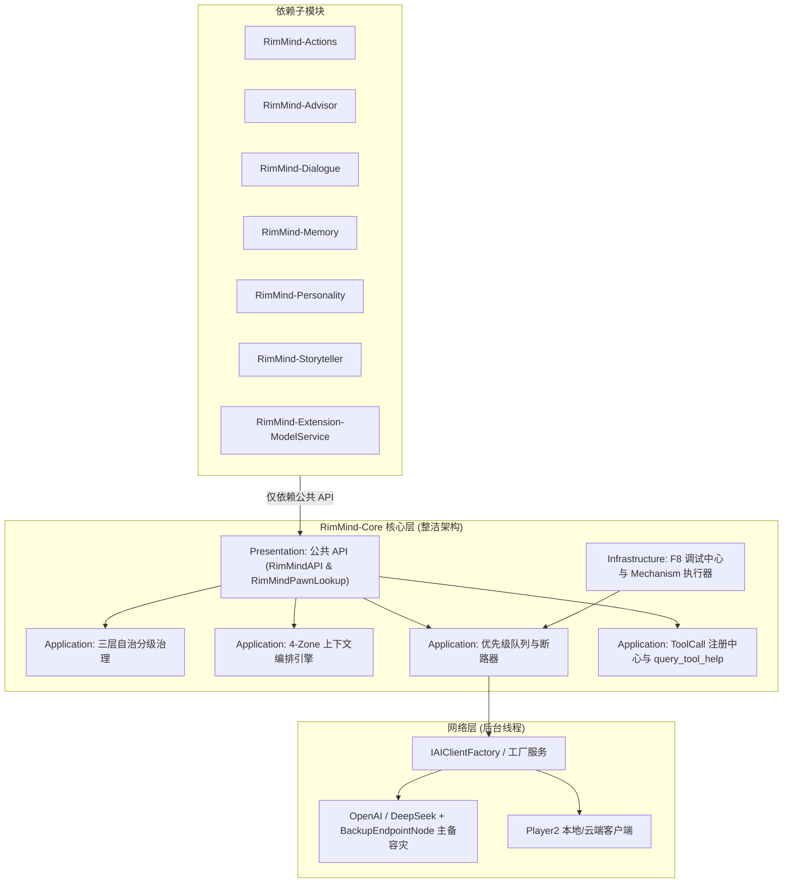

<div align="center">

# RimMind-Core 🧠
### 专为 RimWorld 1.6 & 1.7 打造的底层大模型运行时、上下文编排与 ToolCall 框架

[English](README.md) | **简体中文**

<p>
  <a href="https://rimworldgame.com/"></a>
  <a href="https://github.com/pardeike/Harmony"></a>
  <a href="https://dotnet.microsoft.com/"></a>
  <a href="#"></a>
  <a href="#"></a>
  <a href="LICENSE"></a>
</p>

<p><em>RimMind 智能体生态的核心技术基石。</em></p>

</div>

---

## 📖 模块概览

**RimMind-Core** 为整个 RimMind 模组套件提供底层 AI 基础设施、整洁架构运行时（`Domain` / `Application` / `Infrastructure` / `Presentation`）与公共契约边界（`RimMindAPI`）。所有玩法子模组（`Actions`、`Advisor`、`Dialogue`、`Memory`、`Personality`、`Storyteller`、桥接模组与 `Extension-ModelService`）均严格且仅依赖 `RimMind-Core` 的公开公共 API。

### 核心特性
- **4-Zone KV-Cache 深度前缀优化**：将不变的世界观规则（Zone 1）与小人永久档案（Zone 2）固定在前缀，将历史（Zone 3）与易变的环境时间天气（Zone 4）隔离在报文末尾，实现 80%+ 的前缀缓存命中率。
- **三层智能体自治分级治理（`RimMindAPI.Autonomy`）**：按五大自治领域（`Survival` 生存、`Work` 劳作、`Social` 社交、`Colony` 殖民地、`Governance` 统治）与三档自治级别（`Auto` 自动执行、`AutoWithNotify` 自动并通知、`RecommendOnly` 仅建议审批）结合 `ToolManifest.RiskLevel` 精准门控智能体动作。
- **原生 ToolCall 注册中心与渐进式工具发现（`query_tool_help`）**：强类型工具定义配合 `QueryToolHelpTool` 按需加载详细参数 Schema，大幅压缩常驻 Prompt Token 消耗并彻底杜绝 Markdown 格式解析错误。
- **主备端点容灾与异步优先级请求队列**：纯后台线程执行 HTTP/JSON 请求，内置 `BackupEndpointNode` 主备节点自动故障转移、仅针对真实传输故障计数的 `CircuitBreakerMiddleware` 断路器，并通过 `RequestCompletionInbox` 在主线程安全消费 Unity/Verse 副作用。
- **Pawn 存活与生命周期守卫（`RimMindPawnLookup`）**：提供线程安全的 Pawn 索引与销毁驱逐机制（`IsActiveSpawnedColonist`、`IsEligibleColonist`、`IsActiveColonyAnimal`、`UncachePawn`），杜绝阵亡、离图或囚犯 Pawn 产生幽灵请求。
- **F8 游戏内开发者中枢**：按 `F8` 随时呼出控制中心，支持毫秒级端点测速、队列暂停/清空、自治策略调优与小人上下文报文检视。

---

## 🎮 实机特性展示


*游戏内 F8 调试中心界面：玩家与开发者可实时测试 AI 连通性、观察 Token 前缀缓存效率，并平滑微调并发参数。*

---

## 🏛️ 系统架构与单向依赖



---

## 🛠️ 安装与模组加载顺序

在 RimWorld 模组管理器中，确保 `RimMind-Core` 紧随 Harmony 和原版 Core 加载：

```text
1. Harmony
2. Core (RimWorld 原版)
3. RimMind-Core
4. [其他 RimMind 子模组，按需任意组合启用]
```

---

## ⚙️ 核心设置项

位于 **选项 -> Mod 设置 -> RimMind-Core**：

| 设置项 | 默认值 | 说明 |
|---|---|---|
| **AI Provider** | `openai` | 支持 OpenAI 兼容端点、DeepSeek、Player2 与扩展网关 |
| **API 端点与备用节点** | `https://api.deepseek.com/v1` | 主 OpenAI Chat Completions URL 及 `BackupEndpointNode` 自动故障转移列表 |
| **模型名称** | `deepseek-chat` | 目标大语言模型标识符 |
| **智能体自治策略** | 按领域分级 | 独立配置五大领域（`Survival`/`Work`/`Social`/`Colony`/`Governance`）的自治级别（`Auto`/`AutoWithNotify`/`RecommendOnly`） |
| **最大并发请求数** | `3` | 同时发送给大模型的请求上限（1~10） |
| **请求超时** | `60秒` | 等待 AI 响应的最大超时时限（10~180秒） |
| **请求悬浮窗** | `开启` | 屏幕右下角实时显示请求处理状态与迷你胶囊 |
| **详细调试日志** | `关闭` | 输出完整报文跟踪日志至 `Player.log` |

---

## 🧪 开发者测试指南

在仓库根目录下运行单元测试与架构守护契约测试：

```powershell
# 运行全部单元测试
dotnet test RimMind-Core/Tests/RimMindCore.Tests.csproj -c Release

# 运行架构守卫契约测试
dotnet test RimMind-Core/ArchTests/RimMindCore.ArchTests.csproj -c Release
```

---

## 📜 开源协议

本项目采用 [MIT License](LICENSE) 开源许可证。
